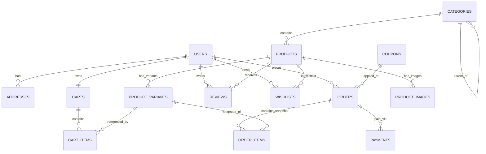

<!-- docs/DATABASE_SCHEMA.md -->
# Thiết Kế Cơ Sở Dữ Liệu (MySQL 8 + Sequelize ORM)

Hệ thống gồm **15 bảng** chuẩn hóa 3NF, sử dụng bảng mã `utf8mb4_unicode_ci`, kiểu tiền tệ `DECIMAL(12, 2)`, hỗ trợ xóa mềm (`paranoid: true` với cột `deleted_at`) cho bảng `products`, và cơ chế khóa dòng (`SELECT ... FOR UPDATE`) khi đặt hàng.

## Sơ đồ Thực thể Liên kết (ERD)

## Đặc tả kỹ thuật các bảng trọng tâm

1. **`users`**: Lưu thông tin tài khoản, mật khẩu băm `bcrypt`, phân quyền `ENUM('user', 'admin')`, token khôi phục mật khẩu.
2. **`addresses`**: Sổ địa chỉ giao hàng của từng người dùng (`province`, `district`, `ward`, `street_address`, `is_default`).
3. **`categories`**: Danh mục đa cấp tự tham chiếu qua `parent_id`, có `slug` unique.
4. **`products`**: Lưu thông tin quần áo (`base_price`, `sale_price`, `gender`, `rating_avg`, `sold_count`, `is_featured`, `deleted_at`).
5. **`product_variants`**: Lưu từng SKU theo tổ hợp `(product_id, size, color)` kèm `color_hex`, `price` riêng và tồn kho `stock_quantity`.
6. **`product_images`**: Nhiều ảnh trên mỗi sản phẩm, gắn `color_ref` để đổi ảnh tự động khi khách chọn màu.
7. **`carts` & `cart_items`**: Lưu giỏ hàng bền vững trên MySQL, giữ nguyên khi người dùng đăng xuất và đăng nhập lại.
8. **`orders` & `order_items`**:
   - `orders`: Lưu mã đơn `order_code`, tổng tiền, phí ship, giảm giá, trạng thái đơn, trạng thái thanh toán và thời hạn thanh toán MoMo `expired_at` (15 phút).
   - `order_items`: Lưu **snapshot bất biến** (`product_name`, `sku`, `size`, `color`, `unit_price`, `quantity`, `total_price`) tại thời điểm mua để việc chỉnh sửa giá sản phẩm về sau không làm sai lệch lịch sử đơn hàng.
9. **`payments`**: Lưu lịch sử giao dịch `COD` / `MOMO` (`request_id` unique, `transaction_id`, `pay_url`, `raw_response` JSON).
10. **`coupons`, `reviews`, `wishlists`, `banners`**: Phục vụ khuyến mãi, đánh giá xác thực mua hàng, danh sách yêu thích và trình diễn Hero 3D.
